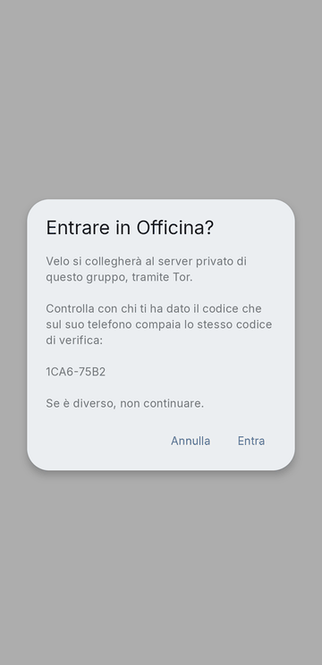
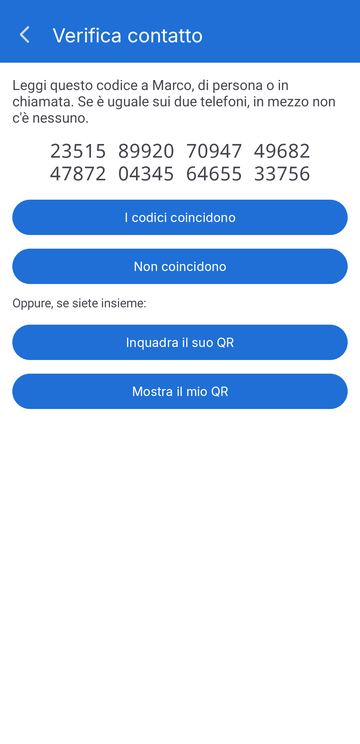
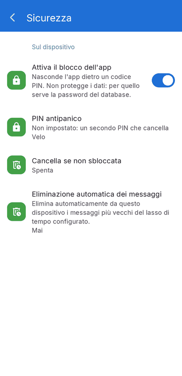
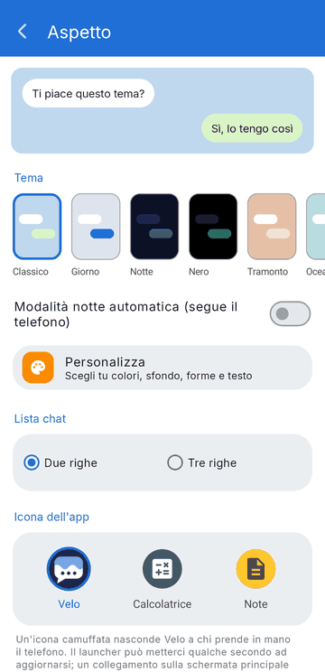

# Velo per Android

**Chat private, cifrate, solo tra voi.** Velo è un'app di messaggi per gruppi chiusi: ogni gruppo ha il
proprio server privato, raggiungibile solo attraverso Tor, e i messaggi viaggiano con una cifratura che
regge anche ai computer quantistici.

[English below](#velo-for-android-english)

- Sito: https://velochat.eu
- Scarica: [ultima versione](https://github.com/castieldev85/velo-android/releases/latest) (`Velo.apk`)
- Licenza: GNU AGPLv3

<p align="center">
  
  
  
  
</p>
<p align="center">
  
  
  
</p>

## Perché Velo

- **Passa da Tor.** Tor è dentro l'app: messaggi, file, foto, storie e contenuti scaricati viaggiano
  solo dentro Tor, verso un server `.onion`: né il server né chi guarda la rete vedono da dove ti
  colleghi. Unica eccezione: l'audio e il video delle **chiamate**, che Tor non può trasportare,
  passano dal server di inoltro (TURN) del gruppo, cifrati da telefono a telefono.
- **Cifratura post-quantistica.** OMEMO2 con scambio di chiavi ibrido classico + ML-KEM-1024
  (libsignal), da telefono a telefono. Il server vede solo dati cifrati.
- **Niente numero di telefono, niente email.** Ti colleghi con un nome utente e un invito (QR o link).
- **Server per gruppo, senza archivio.** Il server tiene un messaggio solo finché non è consegnato,
  poi lo cancella. Nessun registro con gli indirizzi IP.

## Cosa fa

- **Messaggi:** messaggi a tempo, foto e video a visualizzazione singola, elimina per tutti, svuota la
  cronologia anche sul telefono dell'altro, storie che spariscono dopo 24 ore, note personali.
- **Sicurezza del telefono:** PIN di sblocco, PIN antipanico che cancella tutto in silenzio,
  screenshot bloccati, notifiche senza testo, tastiera in incognito, codice di verifica dei contatti.
- **Gestione del gruppo:** inviti con QR, "invita un amico", gestione utenti per l'amministratore,
  cancellazione a distanza del telefono di chi lascia il gruppo.
- **Ogni giorno:** chiamate voce e video, traduzione dei messaggi e dettatura vocale **offline**
  (sul telefono, nessun servizio esterno), temi e sfondi, adesivi, passaggio a un telefono nuovo con
  un QR sulla stessa rete Wi-Fi, senza cloud.

## Installazione

1. Scarica `Velo.apk` dall'[ultima versione](https://github.com/castieldev85/velo-android/releases/latest)
   o da https://velochat.eu e installalo (Android chiede una volta il permesso per le app sconosciute).
2. Apri Velo, tocca **"Ho un invito"** e scansiona il QR del tuo gruppo.
3. Aggiornamenti automatici: aggiungi `https://github.com/castieldev85/velo-android` in
   [Obtainium](https://obtainium.imranr.dev/).

Requisiti: Android 7.0 o più recente, telefono a 64 bit (arm64), circa 90 MB.

### Controlla che sia la Velo vera

L'APK è firmato con il certificato `CN=Velo`. Impronta SHA-256:

```
7e:f1:64:1a:e9:d7:e1:fc:c6:7c:53:b8:5e:c5:3a:0a:d0:10:7e:00:a3:6a:f8:cb:e8:ab:e0:d5:16:68:3f:1d
```

Puoi verificarla con `apksigner verify --print-certs Velo.apk` o con l'app
[AppVerifier](https://github.com/soupslurpr/AppVerifier). Ogni release ha anche il file `.sha256`.

## Compilare dal sorgente

Il repository contiene tutto il necessario, compresi il fork di libsignal (`deps/libsignal`) e il
sorgente della libreria di traduzione offline (`native/velotranslate`).

```
./gradlew assembleVeloFreeRelease -PveloPublic
```

- `-PveloPublic` produce la Velo pubblica (identificativo `eu.velochat.velo`): nessun server
  incorporato, ci si collega con un invito.
- Per incorporare un tuo server, crea `../velo-local.properties` con `velo.login.domain`,
  `velo.onion.host` e `velo.server.pins` (impronte SHA-256 base64 delle chiavi del server) e compila
  senza `-PveloPublic`.
- La firma di release usa le variabili d'ambiente `VELO_KEYSTORE` e `VELO_KEYSTORE_PASSWORD`.

## Da dove viene

Velo è un fork di [monocles chat](https://codeberg.org/monocles/monocles_chat), a sua volta derivato
da [Conversations](https://codeberg.org/iNPUTmice/Conversations) e Cheogram. Usa
[pq-omemo-2](https://codeberg.org/monocles/pq-omemo-2) (libsignal, AGPLv3),
[tor-android](https://github.com/guardianproject/tor-android) del Guardian Project,
[bergamot-translator](https://github.com/browsermt/bergamot-translator) (MPL-2.0) e
[Vosk](https://alphacephei.com/vosk/) (Apache 2.0). Grazie a tutti loro: le note di copyright
complete sono nell'app, in Informazioni.

## Come è fatta

Velo è sviluppata da una persona con l'aiuto di un assistente di intelligenza artificiale
(Claude di Anthropic), che scrive gran parte del codice. Ogni versione viene provata su telefoni veri
prima di uscire, e il codice è pubblico proprio perché chiunque possa controllarlo.

## Avvertenze

Velo non ha ancora avuto una revisione di sicurezza indipendente. Segnalazioni benvenute nelle Issue;
per le vulnerabilità vedi [SECURITY.md](SECURITY.md).

---

# Velo for Android (English)

**Private chats, encrypted, just between you.** Velo is a messenger for closed groups: every group has
its own private server, reachable only through Tor, and messages use encryption designed to resist
quantum computers.

- Website: https://velochat.eu
- Download: [latest release](https://github.com/castieldev85/velo-android/releases/latest) (`Velo.apk`)
- License: GNU AGPLv3

**Highlights:** Tor built in, messages and files only through Tor to a `.onion` server (call audio and
video, which Tor cannot carry, go through the group's TURN relay, end-to-end encrypted); OMEMO2 with hybrid classical +
ML-KEM-1024 key exchange (libsignal); no phone number or email, join with a username and an invite;
one server per group that keeps a message only until it is delivered, no IP logs.

**Features:** disappearing messages, view-once photos and videos, delete for everyone, clear history on
both phones, 24-hour stories; app lock PIN, silent panic PIN, blocked screenshots, notifications without
content, contact verification code; QR invites and admin user management, remote wipe; voice and video
calls, **offline** message translation and dictation, themes, stickers, move to a new phone with a QR
code over local Wi-Fi.

**Install:** download `Velo.apk`, open Velo, tap **"I have an invite"** and scan your group's QR code.
For automatic updates add this repository to [Obtainium](https://obtainium.imranr.dev/). Android 7.0+,
arm64. Signing certificate `CN=Velo`, SHA-256
`7ef1641ae9d7e1fcc67c53b85ec53a0ad0107e00a36af8cbe8abe0d516683f1d`.

**Build:** `./gradlew assembleVeloFreeRelease -PveloPublic` (application id `eu.velochat.velo`, no
built-in server). To build in your own server, create `../velo-local.properties` with
`velo.login.domain`, `velo.onion.host` and `velo.server.pins`.

**Credits:** a fork of monocles chat (from Conversations and Cheogram), with pq-omemo-2 / libsignal,
tor-android, bergamot-translator and Vosk.

**How it is made:** Velo is developed by one person with the help of an AI assistant (Anthropic's
Claude), which writes much of the code. Every version is tested on real phones before release, and
the code is public so that anyone can review it. Velo has not had an independent security audit yet;
for vulnerabilities see [SECURITY.md](SECURITY.md).
